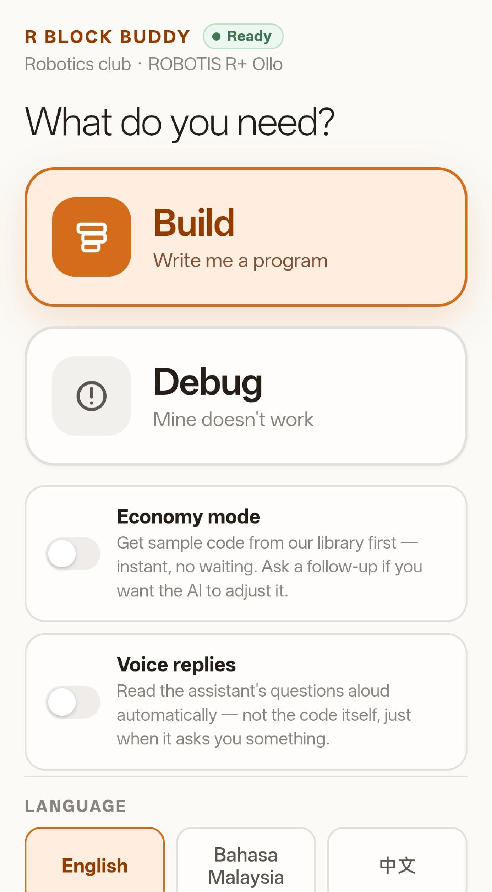
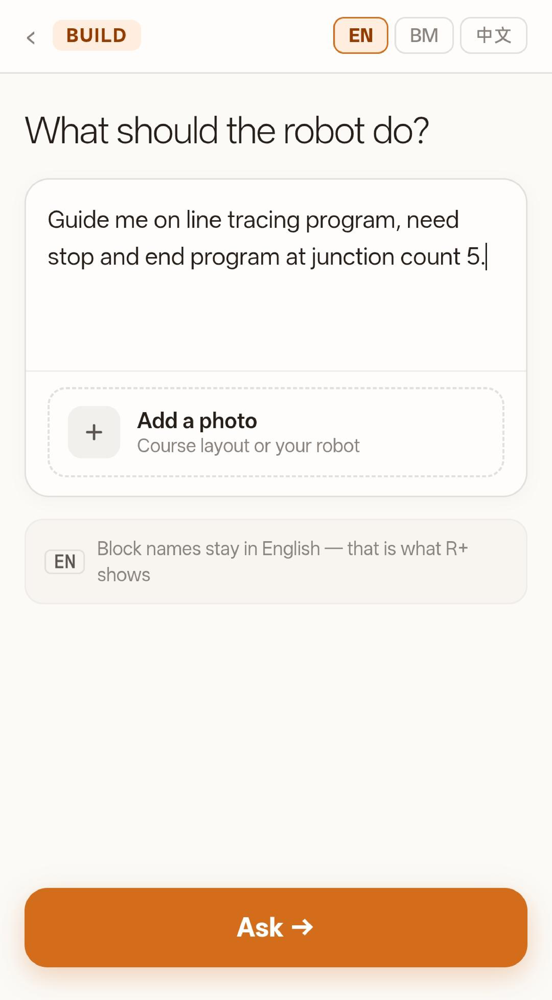
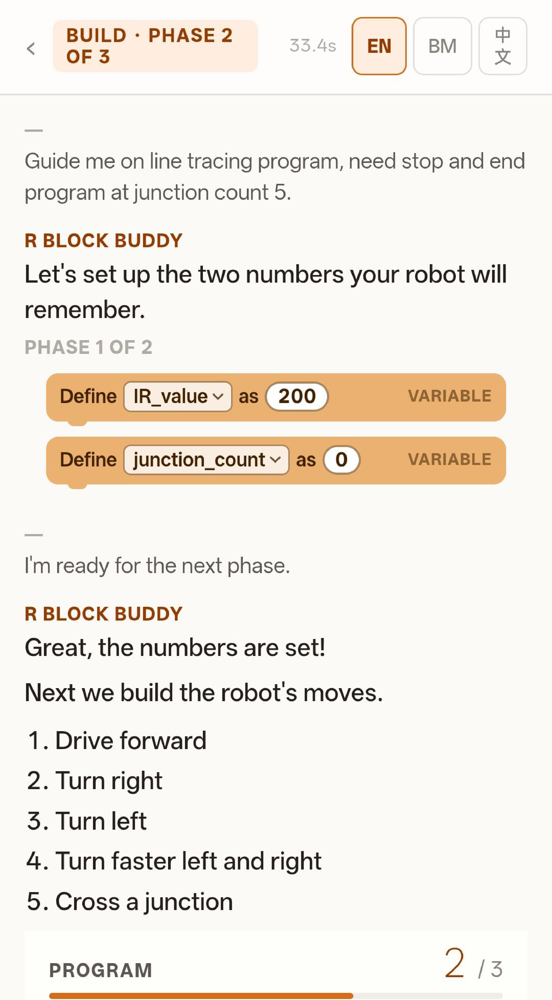
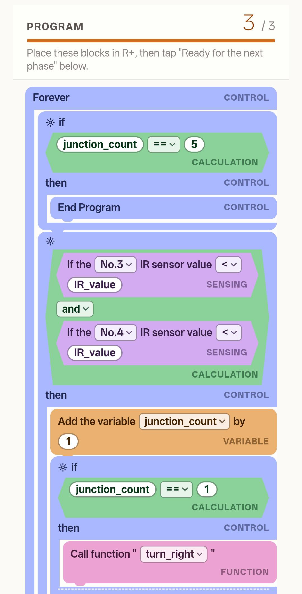

# R Block Coding Buddy

A local-first AI helper for a robotics club, built for students writing
[ROBOTIS R+](https://www.robotis.com/) **R Block** visual-programming code for
Ollo robots. It runs on a single machine (a Mac mini in this deployment), and
is reachable both on the school wifi and, via a Cloudflare Tunnel, from
anywhere.

Students pick **Build** ("write me a program") or **Debug** ("mine doesn't
work"), describe what they need in plain English (optionally with a photo of
the course or their robot), and the assistant replies with real R Block
blocks — correct block names, correct nesting, correct wiring — plus a short
plain-English explanation.

## How it behaves

**Build mode** walks a student through a program in phases rather than
dumping the whole thing at once. A typical Build conversation looks like:

<table>
<tr>
<td width="50%">



Student opens the app and picks **Build** or **Debug**, with Economy mode,
Voice replies, and a language switch (English / Bahasa Malaysia / 中文)
right there on the entry screen.

</td>
<td width="50%">



For Build, the student describes the task in plain English (here: a
line-tracing program that stops at the 5th junction), optionally attaching
a photo of the course or robot. Block names stay in English on purpose —
that's what R+ itself shows.

</td>
</tr>
<tr>
<td width="50%">



The build proceeds phase by phase. Earlier phases' blocks (here, the
Phase 1 variables) stay visible as the conversation continues — nothing
gets overwritten. New instructions come back numbered and broken into
short lines, not a wall of text.

</td>
<td width="50%">



The final phase assembles the main decision loop: a `Forever` block with
the sensor-reading `if` / `else if` chain that calls the movement
functions built in the previous phase.

</td>
</tr>
</table>

1. The student describes the task, e.g. *"Guide me on line tracing program,
   need stop and end program at junction count 5."*
2. The assistant asks any clarifying questions it needs, then starts
   building — e.g. Phase 1 sets up the variables (`IR_value`, `junction_count`),
   Phase 2 builds the individual movement functions (`forward`, `turn_left`,
   `turn_right`, ...), and the final phase assembles the main decision loop
   (the `Forever` block with the `if`/`else if` chain that reads sensors and
   calls those functions).
3. Every earlier phase's blocks stay visible as the conversation scrolls —
   nothing gets overwritten — so a student (or their coach) can always see
   the whole program built up so far, not just the latest step.
4. The student replies "I'm ready for the next phase" (or asks for changes)
   to move on.

**Debug mode** takes a description (and optionally a photo) of what's going
wrong, asks at most one clarifying question, then diagnoses the issue and
explains the fix.

Other behavior worth knowing:

- **Economy mode** answers instantly from a small pre-written skills library
  instead of waiting on the AI model — useful when many students are asking
  at once, or the AI backend is slow/unavailable. A student can still ask a
  follow-up to have the AI adjust the sample.
- **Voice replies** reads the assistant's questions/messages aloud (not the
  block names or code) using ElevenLabs text-to-speech, with a short spoken
  line kept separate from the fuller on-screen explanation.
- **Multi-language UI**: English, Bahasa Malaysia, and 中文. Block names
  always stay in English, matching what R+ actually shows on screen.
- **Answers are validated, not just generated**: every AI response is
  checked against the real R Block catalog and structural rules (block
  nesting, condition counts, etc.) before being shown, with automatic
  retries when the model returns something structurally broken.
- **A password-gated admin panel** (`/admin`) lets a coach switch the AI
  backend/model, edit the system prompts, manage the skills library, and
  view recent error logs — all without touching code or restarting by hand.

## Student levels and block references

In **Admin → Manage student levels**, an admin can add, edit and remove
levels (for example *Spark* and *Excel*). Students pick one from a dropdown
before asking, and the level's prompt is added to the system prompt for that
student.

Each level can also be given specific **directory context** entries (the R
Block reference text, one key per directory tab such as Control or Motion).
A level that picks tabs may only use those tabs' blocks: the model's answer
format is limited to them, and the prompt says so. "Set as default", "Recover
to default" and "Reset factory" manage the default copy
(`vendor/r-block-directory.md`; the original is kept in
`vendor/r-block-directory.factory.md`).

## Knowledge pack (get it from HQ)

What the app knows about R Block — the block catalogue, the prompt text, the
skill library and the design notes — is **not in the public code**. HQ keeps it
as a *knowledge pack*. Without the pack the app does not start (there is no
block catalogue to check answers against).

**Ask HQ for the knowledge pack**, unzip it into the repo root so the folders
line up, then check and restart:

| In the pack | Put it at | Needed? | What it does |
|---|---|---|---|
| `vendor/r-block-directory.md` | `vendor/r-block-directory.md` | **Required** | The block catalogue: every block name and its exact text. Its checksum is verified at startup, so use HQ's file unchanged. |
| `vendor/r-block-directory.factory.md` | `vendor/r-block-directory.factory.md` | For Admin → "Reset factory" | The untouched original copy. |
| `vendor/prompts/*.txt` (9 files: `system_template`, `build_extra`, `debug_extra`, `skill_context_prefix`, `level_context_prefix`, `level_blocks_note`, `no_variables_note`, `use_variables_note`, `use_functions_note`) | `vendor/prompts/` | Optional | The real instructions sent to the model. Without them the app uses the short generic defaults in `app/llm/pipeline.py`. |
| `data/skills.json` | `data/skills.json` | Optional | The skill library (strategy patterns such as Line Following). Without it the library is empty; admins can edit it in Admin → skills. |
| `vendor/line-following-strategy.md`, `docs/adr/`, `CONTEXT.md` | same paths | Optional | Reference and design notes. Documentation only; the app does not read them. |

Steps:

1. Get the knowledge pack from HQ.
2. Unzip it into the repo root (it creates or fills `vendor/`, `vendor/prompts/`, `data/` and `docs/`).
3. Check: `ls vendor/r-block-directory.md vendor/prompts` and `python3 -m pytest -q`.
4. Restart the app. **Admin → Prompts** shows the instructions in use (the prompt files, or the generic defaults if there are none).

Do not edit `vendor/r-block-directory.md` by hand. Admin changes to prompts are saved in `data/prompts.json`; your levels and directory-context edits stay in `data/levels.json` and `data/directory_context.json` on your machine.

## Hosting it locally

### Requirements

- Python 3.10+
- One AI backend, configured via `MODEL_BACKEND`:
  - `ollama` — a local model server (default model used in this deployment:
    `gemma4:12b-it-qat`), free and fully offline, but needs a machine with
    enough RAM/GPU to run it.
  - `gemini` — Google's Gemini API (needs a `GEMINI_API_KEY`).
  - `openrouter` — [OpenRouter](https://openrouter.ai/) (needs an
    `OPENROUTER_API_KEY`); this deployment currently uses `openrouter` with
    `deepseek/deepseek-v4-flash-0731`.
- (Optional) an [ElevenLabs](https://elevenlabs.io/) API key for Voice
  replies.
- (Optional) [`cloudflared`](https://github.com/cloudflare/cloudflared) if
  you want a public URL reachable off your local network, and
  [`qrencode`](https://github.com/fukuchi/libqrencode) if you want a QR code
  printed for that URL.

### Setup

```bash
git clone https://github.com/GenAIMakeEasy/r-block-coding-buddy.git
cd r-block-coding-buddy
python3 -m venv .venv
source .venv/bin/activate
pip install -r requirements.txt
```

Create a `.env` file in the repo root (never commit this file — it's already
in `.gitignore`):

```
MODEL_BACKEND=openrouter          # ollama | gemini | openrouter

# Only the vars for your chosen backend are required.
OLLAMA_MODEL=gemma4:12b-it-qat
GEMINI_API_KEY=
GEMINI_MODEL=gemini-flash-latest
OPENROUTER_API_KEY=
OPENROUTER_MODEL=openai/gpt-6-luna
# Tried in order if the model above fails (comma-separated)
OPENROUTER_FALLBACK_MODEL=deepseek/deepseek-v4.1-flash-1017,anthropic/claude-haiku-5.5
OPENROUTER_TIMEOUT_SECONDS=180
# Cut a slow attempt after this many seconds and retry once (0 = off)
ASK_ATTEMPT_TIMEOUT_SECONDS=60

ELEVENLABS_API_KEY=               # optional, for Voice replies

ADMIN_PASSWORD=                   # required to open /admin
SITE_PASSWORD=                    # required for students to open the app

QUEUE_CONCURRENCY=5               # how many AI requests can run at once
```

### Run it

The simplest way, on macOS, is to double-click
**`Start R Block Coding Buddy.command`** — it starts Ollama if needed, starts
the app server on port `8420`, brings up a Cloudflare Quick Tunnel if
`cloudflared` is installed, and opens the app in your browser.

To run it manually instead (any platform):

```bash
python3 -m uvicorn app.api.main:app --host 0.0.0.0 --port 8420
```

Then open `http://localhost:8420` (students on the same wifi can use your
machine's LAN IP instead). Visit `http://localhost:8420/admin` for the admin
panel.

### Tests

```bash
pytest
```
